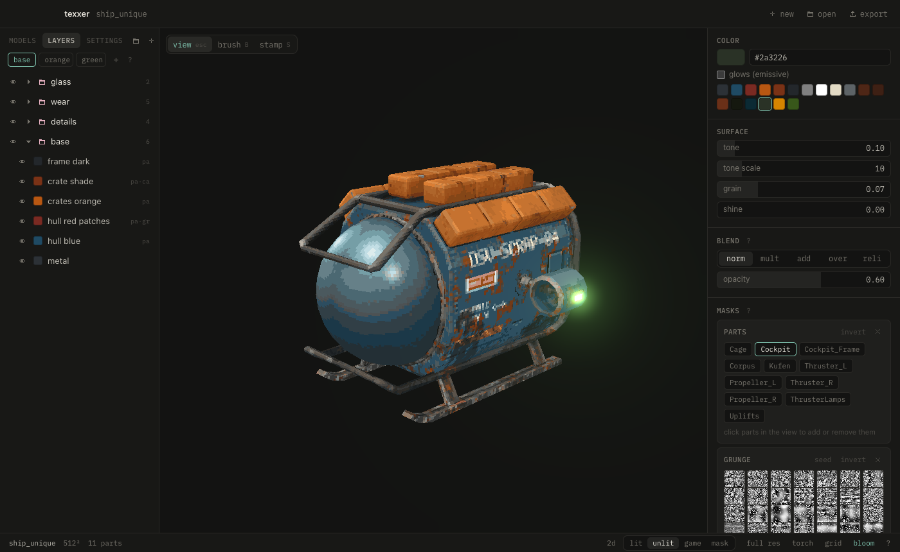

```
 ▀█▀ █▀▀ ▀▄▀ ▀▄▀ █▀▀ █▀█
  █  ██▄ █ █ █ █ ██▄ █▀▄
 ▓▓▒▒░░  paint · mask · crunch
```

A small model painter for crunchy retro textures, PS1 and Quake style. Stack layers on a GLB model, let baked masks put the wear and grime where it belongs, crunch it down to a palette, and send it to Blender or Godot.



## What it does

- **Layers:** colors limited by masks, in folders, with blend modes and per-layer hue, saturation and brightness. Materials (worn steel, painted metal, rust, wood…) and dirt presets come as ready stacks.
- **Masks from the model:** ao, edges, cavity, drips, gradients and facing, baked once from the geometry and the model's own normal and occlusion maps; parts and islands to pick by clicking.
- **Paint and stamp:** a world-space brush, stamps from shapes, decals, text, your PNGs and snippets cut from photos, all projected live and mirrored across x if you like.
- **Channels:** color, ao, roughness and glow, each a stack of its own, with an onion skin of another.
- **Crunch:** supersampled and sharpened, baked light, then an auto palette by median cut, Quake's or a file, with optional dither.
- **See it in game:** lit, unlit and a Godot-like game view, mipmaps like Godot's nearest_mipmap, a torch and game resolution.
- **UVs:** paint on the model's UVs or let texxer lay out its own, pixel-aligned at one texel density. The 2D view shows cuts and overlaps.
- **Variants:** player colors and the like, each exported as its own texture.
- **Blender:** a sync button in Blender sends the objects over, the texture shows up live in a material.
- **Export:** into the GLB in place, PNGs beside it, emission, roughness and occlusion included for Godot.

## Run

Needs Go, Node and [Wails](https://wails.io) v2 (`make` installs Wails when it's missing).

```sh
make dev       # app window, plus http://localhost:34115 in a browser
make build     # bin/texxer.app
make install   # into /Applications
make dist      # dist/: macOS (universal) and Windows zips, each with the Blender add-on
make dist-linux  # on Linux, needs libgtk-3-dev and libwebkit2gtk-4.1-dev
make test
```

## Download

The latest release, each with the Blender add-on: [macOS](https://github.com/sloptools/texxer/releases/latest/download/texxer-mac.zip), [Windows](https://github.com/sloptools/texxer/releases/latest/download/texxer-windows.zip), [Linux](https://github.com/sloptools/texxer/releases/latest/download/texxer-linux.tar.gz). The Mac app isn't signed: open it the first time with right click › Open.

## Blender

Install `tools/blender/texxer_bridge.py` via Preferences › Add-ons › Install from Disk, save the `.blend`, select the objects and press **sync** in the sidebar tab **texxer**.

## Grunge maps

texxer ships maps made from noise: clouds, blotches, grime, specks, streaks, scratches and lines. Drop your own square gray maps (white = dirt, best tileable, PNG or JPG) into `~/Library/Application Support/texxer/grunge`; the last tile of a grunge mask's map grid opens it. `go run ./tools/grunge -root <dir> -list <file>` turns photos into such maps.

## License

MIT, see [LICENSE](LICENSE). IBM Plex Mono is under the SIL Open Font License.

## Help

Press `?` or `F1` in the app: the docs from [`docs/`](docs) and every key.
