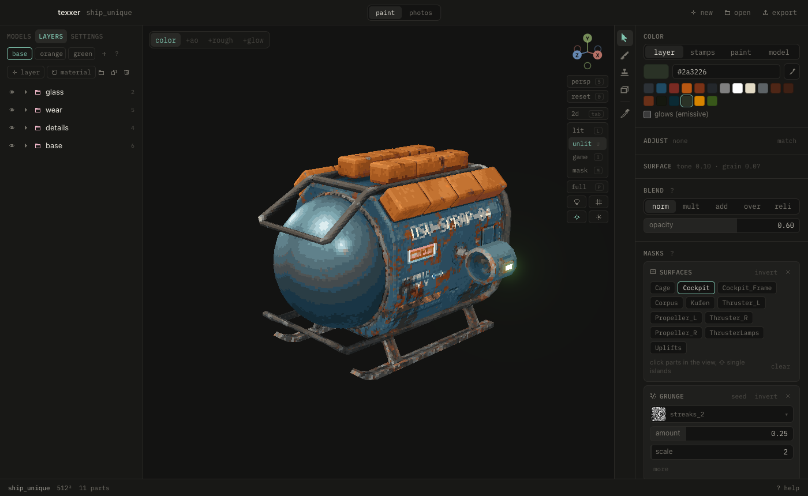

# Start

texxer paints textures for GLB models: a stack of layers, each a color limited by masks, crunched down to a few colors and baked light.

1. **⌘N** new project, then add models with **+** in the models tab. Or **⌘O** to open a single GLB.
2. Add layers (**⇧N**), give them a color and masks.
3. Judge the look in the views: **L** lit, **U** unlit, **I** in game, **Tab** flat texture.
4. **⌘E** writes the texture into the model's file.

Everything saves on its own. **?** shows all shortcuts. Sliders: drag sideways (**⇧** finer), click to type a value, double-click resets.

## View

Two fingers orbit, **⇧** two fingers pan, pinch zooms to the cursor, **⌥** two fingers turn the key light. With a mouse: drag or middle drag orbits, right drag pans, the wheel zooms, **⇧** right drag turns the key light. Holding **space** orbits with any tool, the arrows orbit in steps. If texxer mixes up mouse and trackpad, set **scrolling** in settings. On Windows and Linux **ctrl** does what **⌘** does. **1 3 7** front, side, top, **0** or **reset** under the gizmo resets, **F** focus the point under the cursor.

The gizmo top right does the same: click an axis to look along it, again for the other side, drag it to orbit. Axis views are ortho until you orbit; **5** switches ortho and perspective. Below it: 2D, the view modes, game resolution, torch, grid, bloom and the view's lights.

The tools are in the strip right of the view: view and pick surfaces, brush, stamp, volume, and the pipette. Their settings show at the top of the panel beside it. **⌘B** hides and shows the layers on the left, **⇧⌘B** that panel, **N** the view bar under the gizmo.
