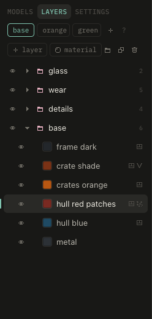

# Layers

Layers stack bottom to top. A layer without masks covers everything.

- **color**: the layer's color. Swatches reuse colors of other layers.
- **tone**, **tone scale**: lighter and darker patches over the color, at a world size.
- **grain**: single texels a bit lighter or darker.
- **shine**: baked sheen and glints, for glass and gloss.
- **glows**: the color also goes into the emissive map.
- **blend**: normal, multiply, add, overlay, relief. Relief takes gray stamps as bumps: mid gray keeps the surface.
- **opacity**

**N** new, **D** duplicate, **⌫** delete, **V** show or hide, **↑ ↓** select, **⌥↑ ⌥↓** move.

## Folders

**⌘G** puts the layer into a new folder, **⇧⌘G** dissolves it. Drag layers onto a folder to put them in. Folders hide and show all their layers.

Click a folder to give it a **zone**: then click surfaces in the view to add them (**⌘click** for whole parts). Its layers show only there. Without a zone, the folder covers everything.

## Materials

A material is a folder of layers: worn steel, painted metal, rust, wood, plastic, rubber, glass. **⇧M** or the ball above the layers adds one above the selected layer, picked so the next clicks set its zone. Put the main material first without a zone, then the others with theirs.

**save** in a folder's panel keeps it as your own material, for every project. Parts, islands, paint and stamps stay with the model.
