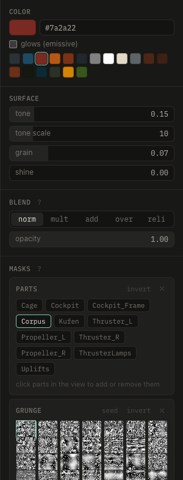

# Masks

A mask decides where a layer shows. With several masks, the layer shows where all of them do. **M** shows the selected layer's mask.

**+ mask** adds one; it replaces an empty paint or stamps mask. Most masks have **amount** (how much shows), **soft** (edge falloff), **rough** (a noisy edge) and **invert**. Soft and rough show once set, or under **more**.

| mask | shows where |
|---|---|
| parts | the picked parts of the model. **⌘click** a part to add it |
| islands | the picked surfaces, bounded by hard edges. **⇧⌘click** to add one |
| paint | you paint with the brush |
| stamps | stamps sit |
| volume | inside a box, cylinder or sphere you move in the view, all around the model. **soft** fades it towards its walls |
| grunge | a grunge map, projected from three sides |
| ao | the surface is occluded |
| edges | convex edges, for wear. **1–3 px** gives crisp lines that many texels wide |
| cavity | creases, gaps and corners where surfaces meet, for grime. **1–3 px** as for edges |
| drips | below edges, running down walls. **rough** varies their length |
| gradient | rises from one side: below, above, left, right, back, front (as in a front view) |
| facing | the surface faces a direction |
| noise | value noise |

Use parts or islands for zones, ao, edges and cavity for wear. Volume with grunge puts dirt exactly where you want it.

**Q** edits the layer's volume, adding one if needed: click the model to put it there, drag it over the surface, or use the gizmo. **W E R** move, turn and size, **X** mirrors it across x. Prefer hard cuts: soft masks read as smears once crunched.
