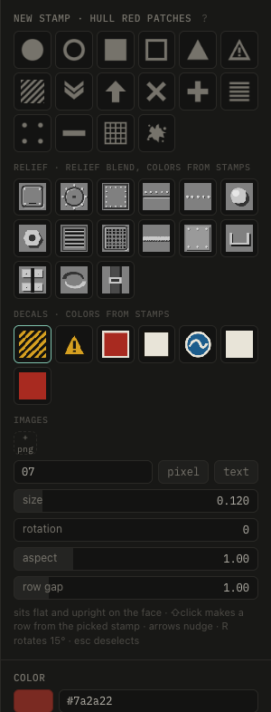

# Brush and stamps

**B** brush, **S** stamp, **Esc** back to the view tool. Both paint into the selected layer and add the mask they need.

## Brush

Paints into the layer's paint mask. **[ ]** size, **⌥** or **E** erase, **⇧click** a straight line, **X** mirror across x.

## Stamps

Click to place, drag to move. Shapes, relief stamps (for the relief blend), decals, your PNGs (**+ png**) and text: **pixel** is a 5×7 font that stays readable at low sizes.

**R** rotate 15° (**⇧R** back), **G** snap to a grid on the surface, arrows nudge, **D** duplicate, **⇧click** a row from the picked stamp, **⌫** delete.

Layers with **colors from image stamps** take the colors of decals and images instead of their own.
