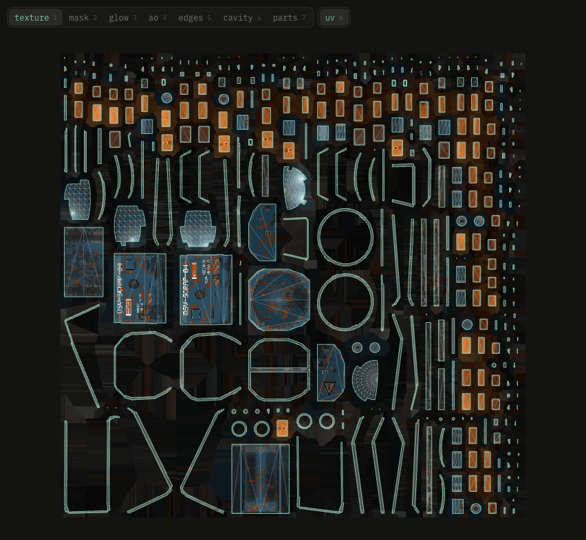

# UVs and the flat view

**uv** in settings switches between the model's own UVs and texxer's layout. texxer cuts at hard edges, flattens, turns every piece upright onto the pixel grid and packs all at one texel density. Models with missing or overlapping UVs start with texxer's layout. Painted masks move along when you switch.

The layout is made for a texture size. After changing the size, **lay out for …** makes a new one.

## Flat view

**Tab** lays the texture flat. **1–7** texture, mask, glow, ao, edges, cavity, parts. **W** shows the UV layout: cuts in teal, unused space dark, overlaps in red. Two fingers or dragging pan, pinch or the mouse wheel zooms, **0** fits.
