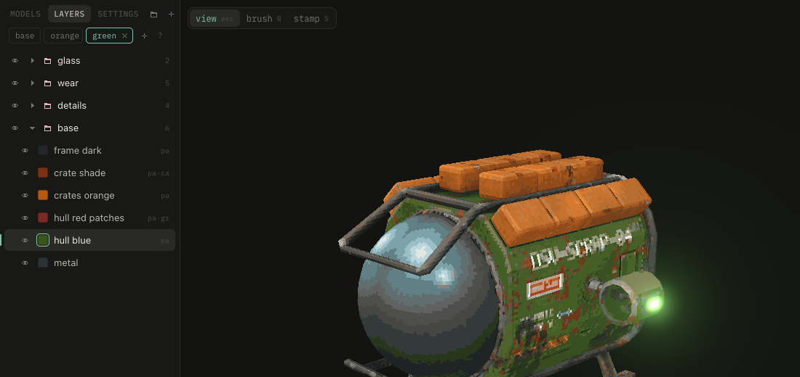

# Variants

A variant changes color, visibility and opacity of some layers, like a player color. The bar above the layers switches between **base** and the variants, **C** cycles.

While a variant is active, those three edits go to it. A ring around a layer's swatch marks layers it changes. Double-click a variant to rename it.

The export writes `<model>_<variant>.png` for each, beside the base texture.
