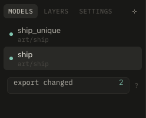

# Projects and export

A project is a `.texxer` file anywhere. It lists models; each has its own texture, layers and variants. Painted masks sit in a folder beside the project.

- **models** tab: **+** adds GLBs, or drop them in. Double-click renames, **×** removes from the project (the files stay).
- **⌘P** switches by name, **PgUp PgDn** steps through.
- The **+** on a model adds more GLBs that share its texture, like attachments. They are laid out side by side and painted together.
- The folder on a model picks where the export puts its PNGs, e.g. a shared `_textures` folder. Cancelling puts them beside the files again.

## Tiles

**tile** in the models tab adds a tile: a wall texxer makes itself, for walls, floors and other surfaces that repeat. Its size in meters (**0.5** to **4**, width and height apart) sits in settings; the texture size counts along the longer side. The view shows it with its neighbors, the 2D view its repeat dimmed below or beside it.

Everything runs on across the seams: noise, tone, grunge, stamps, volumes and brush strokes. Edges, cavities, AO and drips stay empty, as a tile has no shape; give it depth with stamps (relief, sunk or raised). Gradients repeat too, so they show a seam. Changing its size keeps the paint where it is in the texture.

Its export writes only the PNGs, cut to the tile, into `textures/` beside the project or the tile's folder.

## Export

**⌘E** writes PNGs beside the model's GLB files or into its folder: `<model>.png`, emissive, variants, and on texxer's layout normal and occlusion maps. The GLBs are updated in place and link those PNGs instead of carrying a copy, so Godot and Blender use them directly.

The dot beside each model shows what it needs: dim when exported, teal when edited, not exported yet or its file changed (when Blender wrote it again), red when the file is missing. **⇧⌘E** exports all models that need it.
